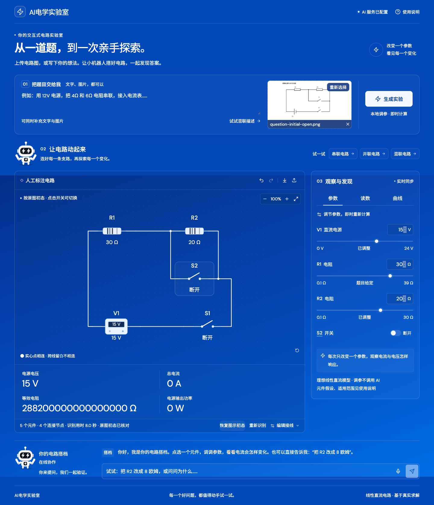
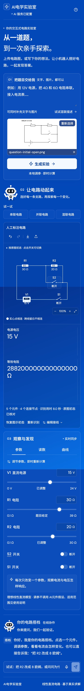

> V7：按需解题并填入已核对的答案、点击元件聚焦填写、空数值框和机器人自我介绍，见[说明](docs/WORKSPACE_V7.md)。

> 2026-10-31：新增单屏工作区、流畅输入/滑条、可填写的电表计算结果、识别后聊天填值引导及双掷开关三档。见[本轮说明](docs/WORKSPACE_V6.md)。

> 2026-10-31 V5：新增SI单位保真、标准LED/电容等符号、独立题目测量条件、通用两端元件编辑、直流稳态电容与明确参数的二极管近似。没有重复运行题单、E2E或真实AI回归；能力及未实现的多端/动态模型详见[本轮说明](docs/VISION_V5.md)。

# AI电学实验室

中文单页交互式电路实验室：输入电路题文字、上传图片或拍照，由 DeepSeek 提取真实的节点连接，机器人按识别结果逐项搭建，调参后在浏览器本地计算电流、电压、功率与扫描曲线。

公开页面：https://simonxz578.github.io/AI-Circuit-Experiment/

独立后端：https://ai-circuit-lab-api.simonxz578.workers.dev/api/health

## 可以做什么

- 文字与 PNG/JPEG/WebP 图片联合输入，最大 2 MB；原图缩略预览、取消、重试和错误说明。
- AI 只提取电连接，由本地程序排版和正交绕线：支路分行、导线避开元件和标签、实心点标记电连接。点击选择、缩放、拖动及平移；调参和开关状态不改变布局。
- 直流电源、电阻、滑动变阻器、理想电流表/电压表、导线、开关、保险丝通断模型；多电源与桥式电阻网络使用修正节点分析求解。
- 参数面板、读数表、I–V / I–R / 自定义扫描、CSV 与曲线 PNG、实验配置导入导出。
- 文字指令调参、开关控制；AI 解释与串联/并联增加元件、改接线等结构化操作，接线修改先预览后确认；撤销/重做。
- 浏览器支持时语音转写为草稿，检查后发送。转写服务由浏览器提供，与文字命令共用控制通路。
- 纯蓝背景、纯白文字、闪电眼睛与双臂充电机器人；中文界面、可读字号、键盘焦点和减少动画模式。
- 原图初态与题干后续条件分离；图中开关可直接点击或按回车/空格切换，右侧同步，支持恢复图示初态。

## 支持范围与限制

本项目不是“任意电路都准确”的承诺。求解器支持理想**线性定常直流**网络。灯泡的非线性、电容/电感瞬态、二极管与交流源会保留图形并提示当前不支持，不能悄悄替代成电阻或伪造曲线。保险丝仅提供通断，不模拟熔断热过程。理想导线/闭合开关的单独支路电流不报告，可串入电流表。

AI 识别仍可能误读接线。低置信度、实质不确定、可疑断路或不可解拓扑需要复核；缺失参数保持待填写，不使用猜测值。几何交叉不构成连接，电连接唯一由节点与导线定义。拖动仅修改位置。改接线时请对照原图。

当前识别分为完整题目元件/给定值读取、电路裁图端子提取、触点像素核验。接线阶段不读取正文中的后续开关操作。模型只把开关标号对应到像素候选，真实开合由局部连通性判断；定位或图像不可靠时明确显示待确认，不把模型猜测当成初态。

本轮使用16张不同的初高中电路图进行18项真实回归（用户原图重复三次），覆盖横向/竖向与混合开关状态、支路、仪表、变阻器、桥式和无点跨线，逐项核对人工端子与参数真值。完整记录与限制见 [本轮报告](docs/VISION_V4.md)。首次识别耗时仍受模型负载和有限复核影响，本地切换开关和调参不需要重新识别。

语音依赖浏览器、网络、语言与麦克风权限；自动测试验证了转写后的命令路径，未使用真人麦克风验证各平台转写质量。Chrome/Edge 支持情况优先，其他浏览器可用文字输入。

## 本地运行

需要 Node.js 24 和 npm。

```bash
npm ci
cp .env.example .env.local
npm run dev
```

打开 `http://127.0.0.1:5173/AI-Circuit-Experiment/`。上述配置使用已部署的后端，不需要在前端放入密钥。示例与本地求解可在 AI 服务不可用时使用。

如需自己的后端：

```bash
npx wrangler login
npm run deploy:api
python3 scripts/configure-key.py
node scripts/deploy-secret.mjs
```

先在 `worker/wrangler.jsonc` 中为自己的部署修改独立 Worker 名称及允许的前端来源。密钥通过隐藏输入保存到权限 600 的 `worker/.dev.vars`，由标准输入上传 Secret；该文件被 Git 忽略。仅使用新 AI Circuit Key，不读取或迁移 Ninefold 密钥。

本地开发后端：`npm run dev:api`；将 `.env.local` 的 `VITE_API_URL` 设为 `http://127.0.0.1:8787` 后重启前端。

## 架构与用量控制

React + TypeScript + Vite → Cloudflare Worker → DeepSeek `deepseek-flash` 真实图像输入 → schema 核验 → CircuitDocument → 本地修正节点分析 → 同步绘图、表格与操作。

绘图使用独立的串并联分解与通用网格回退、A* 正交绕线，忽略模型坐标，保留真实端子。数值求解与几何布局分离；仅拓扑或手动位置变化会重新绕线。相同文字与原图的成功识别在当前页面内存中最多复用 3 份、10 分钟，不写入浏览器持久存储；「重新识别」强制重新调用。刷新页面即清除。

CircuitJS1 经过方案调查后未引入：当前承诺范围是线性定常 DC，独立 MNA 更轻量、可直接测试，无同源 iframe 依赖。非线性与瞬态能力不作虚假声明。

Agent 输出受限操作，由确定性编译器修改节点，避免直接信任 LLM 生成的整份替代电路。数值读数来自求解器；对话只收到当前电路精简摘要，不保存历史、图片或录音。

后端 Secret 不进入构建产物。保留严格来源控制、格式与大小检查、约120秒任务预算、网页135秒等待上限。每次图像识别执行完整题目读取和电路裁图提取，出现分歧最多再复核一次，总计最多3次上游调用；不无限重试。

按用户要求，应用自行设置的全站每日、每访客每日、每分钟次数限制已全部取消。请求不再访问历史额度计数，也不再为限额计算访客IP哈希；旧Durable Object绑定只为兼容既有部署而保留，不再计数或拒绝。DeepSeek实际返回的429、授权与余额问题会准确反馈。`AI_ENABLED=false` 仍可由维护者暂停AI功能。

## 验证

```bash
npm test
npx tsc -p worker/tsconfig.json
npm run build
npx playwright install chromium
npm run dev
# 另一个终端：
npm run test:e2e
# 真实 API 验证，会使用公开后端额度：
npm run test:live
```

详见 [测试报告](docs/TEST_REPORT.md)、[真实 API 证据](docs/evidence/live-report.json) 与 [复用及许可说明](docs/REUSE.md)。界面测试中模拟的 API 仅用于可重复验证错误态/缺值/确认流程，真实 API 证据单独保存。





## 发布

GitHub Actions 自动验证单元测试、Worker 类型与生产构建，并发布 GitHub Pages。Vite base 为 `/AI-Circuit-Experiment/`。后端在独立 Worker 部署，Pages 构建无需 DeepSeek 密钥；更改 API 代码后单独运行 `npm run deploy:api`。
